# CẤU TRÚC SƠ ĐỒ TRANG WEB (CATBOX SITEMAP SPECIFICATION)

---

## 1. BIỂU ĐỒ CẤU TRÚC TỔNG THỂ (MERMAID SITEMAP)

```mermaid
graph TD
    Root["🌐 CATBOX WEBSITE (Homepage)"]

    %% Branch 1: About Us
    Root --> About["👥 ABOUT US (/about-us)"]
    About --> A1["Tầm Nhìn (Vision)"]
    About --> A2["Sứ Mệnh (Mission)"]
    About --> A3["Giá Trị Cốt Lõi (Core Values)"]
    About --> A4["Văn Hóa Doanh Nghiệp"]
    About --> A5["Năng Lực Sản Xuất (Factory)"]
    About --> A6["Quy Trình Làm Việc"]
    About --> A7["Chính Sách Công Ty"]

    %% Branch 2: Industry
    Root --> Industry["🏭 INDUSTRY (/industry)"]
    Industry --> I1["Mỹ Phẩm & Chăm Sóc Cá Nhân"]
    I1 --> I1_1["Hộp đựng mỹ phẩm"]
    Industry --> I2["Dược Phẩm & Wellness"]
    I2 --> I2_1["Hộp dược phẩm"]
    I2 --> I2_2["Toa thuốc"]
    I2 --> I2_3["Nhãn lọ thuốc"]
    Industry --> I3["Thực Phẩm & F&B"]
    I3 --> I3_1["Túi / Bao bánh mì"]
    I3 --> I3_2["Giấy gói chống thấm dầu"]
    I3 --> I3_3["Hộp bánh sinh nhật"]
    I3 --> I3_4["Hộp đựng thức ăn giấy"]
    I3 --> I3_5["Hộp bánh trung thu"]
    Industry --> I4["Quà Tặng Doanh Nghiệp & Sự Kiện"]
    Industry --> I5["Thời Trang & Phụ Kiện"]
    I5 --> I5_1["Túi giấy thời trang"]
    I5 --> I5_2["Hộp trải nghiệm sản phẩm"]

    %% Branch 3: Product
    Root --> Product["📦 PRODUCT (/products)"]
    Product --> P1["Hộp Giấy Mềm"]
    Product --> P2["Hộp Bồi Sóng"]
    Product --> P3["Hộp Carton Lạnh"]
    Product --> P4["Túi Giấy"]
    P4 --> P4_1["Túi xỏ quai xoắn"]
    P4 --> P4_2["Túi quai tết"]
    P4 --> P4_3["Túi quai ribbon"]
    P4 --> P4_4["Túi quai ribbon giấu quai"]
    Product --> P5["Phong Bì"]
    Product --> P6["Giấy Gói"]
    Product --> P7["Bao Bánh Mì"]
    Product --> P8["Sticker Tem Nhãn"]
    Product --> P9["Tag / Mác Treo"]
    Product --> P10["Hộp Đựng Quà Tết"]
    Product --> P11["Hộp Bánh Trung Thu"]

    %% Branch 4: Case Study
    Root --> CaseStudy["📁 CASE STUDY (/case-studies)"]
    CaseStudy --> CS_List["Danh Sách Dự Án (Solutions)"]
    CaseStudy --> CS_Detail["Chi Tiết Từng Dự Án"]

    %% Branch 5: Sharing
    Root --> Sharing["📢 SHARING / BLOG (/sharing)"]
    Sharing --> S_List["Danh Sách Bài Viết (Engagement/SEO)"]
    Sharing --> S_Detail["Chi Tiết Bài Viết Chuẩn SEO"]

    %% Branch 6: Contact
    Root --> Contact["📞 CONTACT (/contact)"]
    Contact --> C_Form["Form Tư Vấn Báo Giá"]
    C_Form --> C1["Khách đã có thiết kế sẵn"]
    C_Form --> C2["Chưa có thiết kế, cần tư vấn từ đầu"]
    C_Form --> C3["Nhu cầu khác"]

    %% Branch 7: Footer
    Root --> Footer["📄 FOOTER & LEGAL"]
    Footer --> F1["Chính sách bảo mật"]
    Footer --> F2["Điều khoản sử dụng"]
    Footer --> F3["Chính sách giao hàng & thanh toán"]
    Footer --> F4["HTML Sitemap"]
```

---

## 2. QUY HOẠCH URL & CÁC TRANG CON

| Trang chính | URL Path | Loại Template | Mô tả chức năng |
| :--- | :--- | :---: | :--- |
| **Trang chủ** | `/` | `Homepage` | Showcase visual Dark Luxury, giới thiệu tổng thể thương hiệu. |
| **Giới thiệu** | `/about-us` | `AboutPage` | Hồ sơ năng lực, xưởng in, quy trình làm việc, chứng nhận chất lượng. |
| **Lĩnh vực** | `/industry` | `IndustryArchive` | Danh sách 5 lĩnh vực trọng tâm (Mỹ phẩm, Dược phẩm, F&B, Quà tặng, Thời trang). |
| **Chi tiết lĩnh vực** | `/industry/[slug]` | `IndustryDetail` | Giải pháp bao bì chuyên biệt cho từng ngành nghề kèm hình ảnh mẫu. |
| **Danh mục sản phẩm** | `/products` | `ProductArchive` | Lưới sản phẩm kèm bộ lọc theo chất liệu (Hộp cứng, túi giấy, bao bì mềm...). |
| **Chi tiết sản phẩm** | `/products/[slug]` | `ProductDetail` | Thông số kỹ thuật, bảng quy cách, nút nhận báo giá nhanh qua Zalo/Form. |
| **Dự án tiêu biểu** | `/case-studies` | `CaseStudyArchive` | Portfolio các thương hiệu đã hợp tác (Vincom, Lotte, Almaz...). |
| **Chi tiết dự án** | `/case-studies/[slug]` | `CaseStudyDetail` | Hình ảnh mockup thực tế, câu chuyện thương hiệu và thành phẩm. |
| **Blog & Kiến thức** | `/sharing` | `BlogArchive` | Các bài viết chia sẻ kinh nghiệm in ấn và kéo SEO từ khóa ngành. |
| **Chi tiết bài viết** | `/sharing/[slug]` | `BlogDetail` | Nội dung bài viết chuẩn SEO On-page, mục lục tự động (TOC), nút chia sẻ. |
| **Liên hệ & Báo giá** | `/contact` | `ContactPage` | Form thông minh phân loại 3 tệp khách hàng + Google Maps + Hotline. |
| **Chính sách** | `/policies/[slug]` | `PolicyPage` | Quy định giao hàng, bảo mật, thanh toán và điều khoản dịch vụ. |
