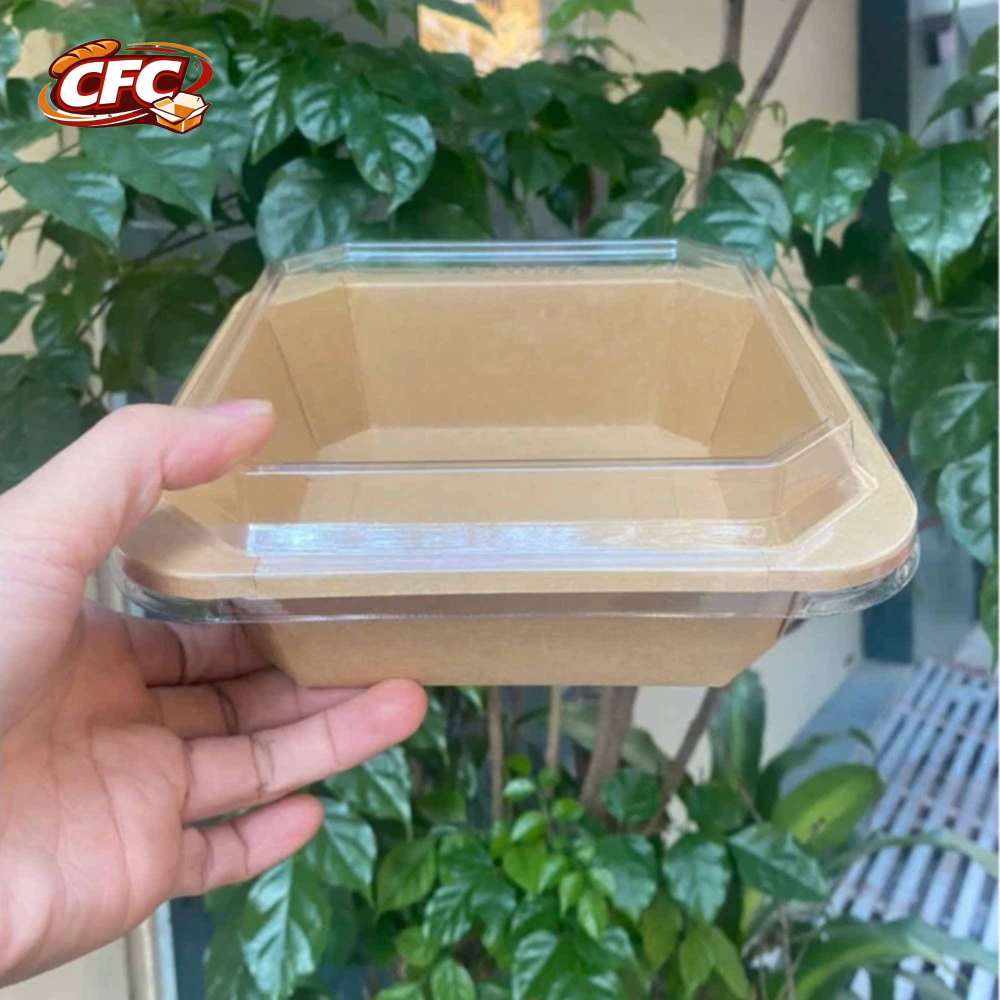
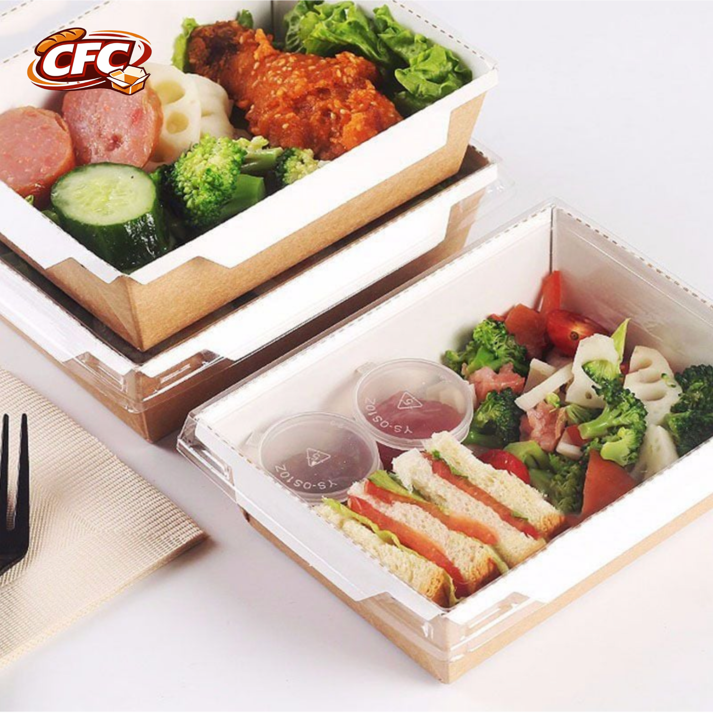
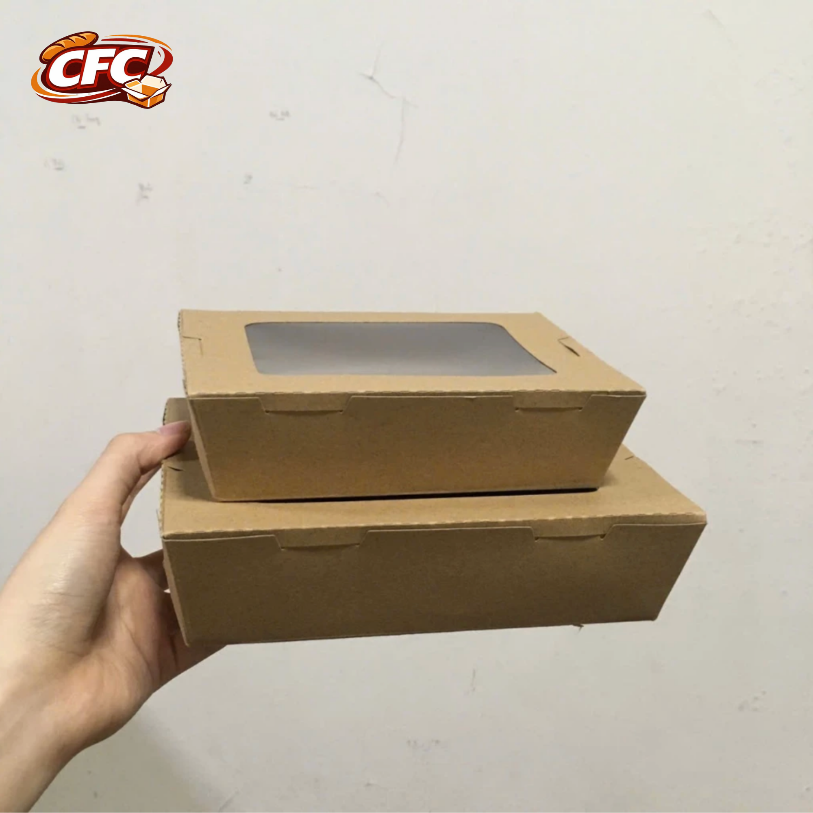
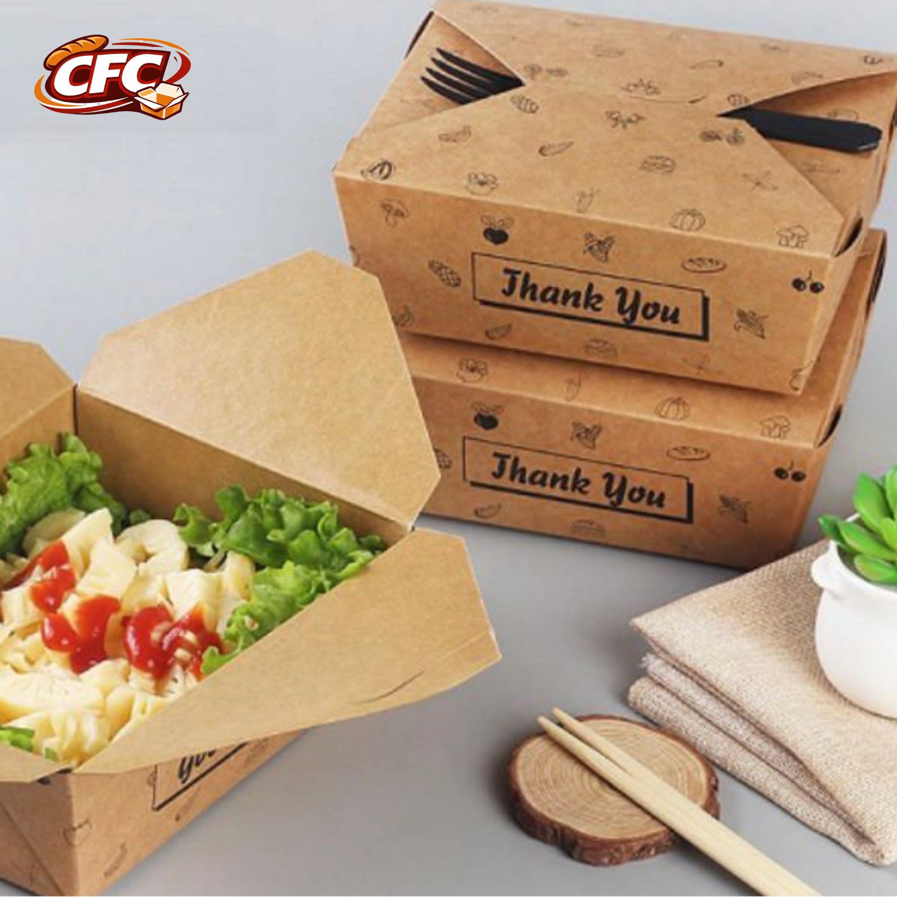
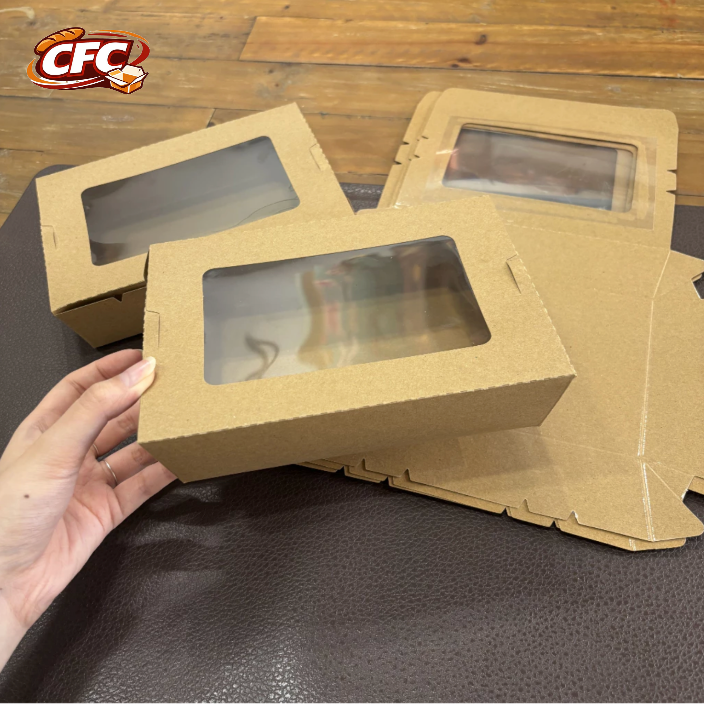
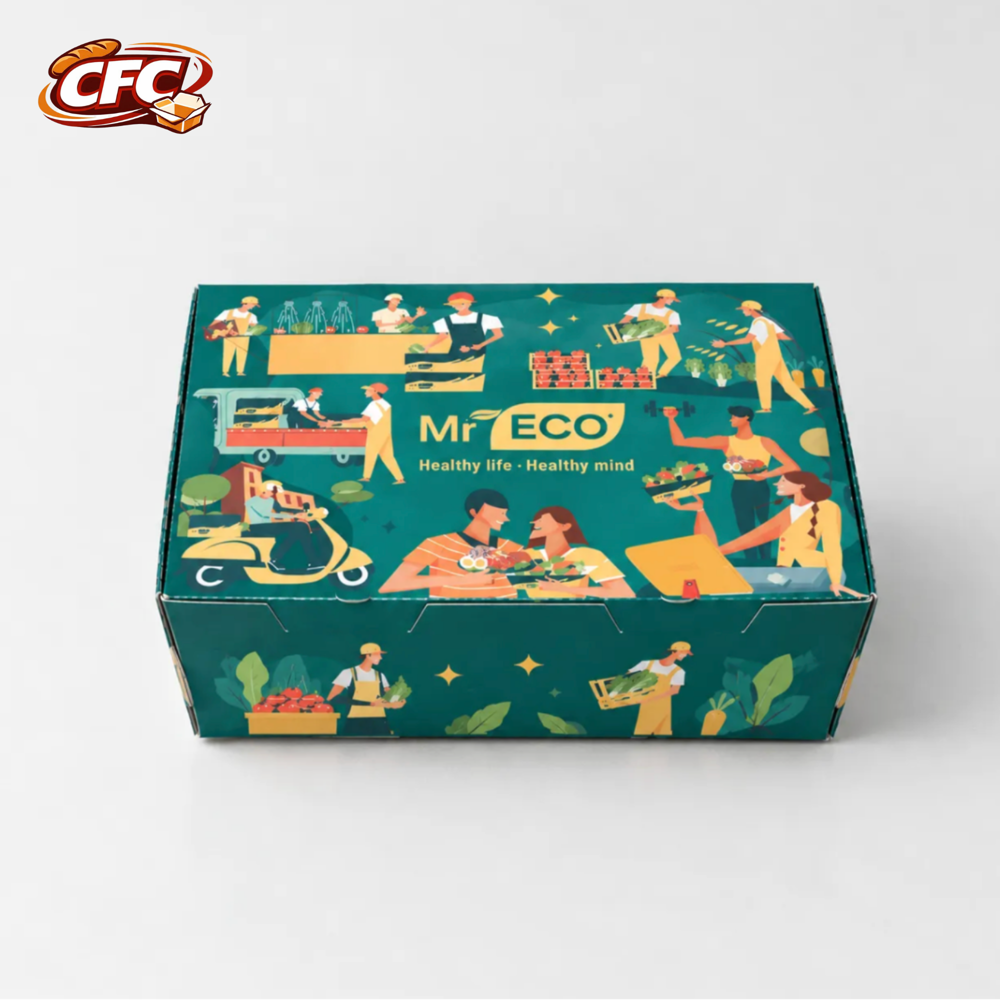

# **5+ Mẫu Hộp Giấy Đựng Salad Nắp Liền, Nắp Rời Chống Thấm Tốt**

Salad thường kết hợp rau củ tươi, thịt, trái cây và các loại nước sốt nên cần bao bì phù hợp để giữ món ăn gọn gàng, hạn chế rò rỉ khi mang đi. Trong đó, **hộp giấy đựng salad nắp liền và nắp rời** là hai kiểu được nhiều cửa hàng cân nhắc nhờ thiết kế tiện dụng, dễ đóng gói.

Cùng CFC tham khảo 5+ mẫu hộp phổ biến và cách chọn hộp phù hợp với nhu cầu kinh doanh nhé!

## **1. 5+ Mẫu Hộp Giấy Đựng Salad Phổ Biến**

### **1.1. Hộp giấy vuông đựng salad**

Hộp vuông có thiết kế gọn gàng, phù hợp với khẩu phần salad nhỏ hoặc món ăn kèm. Kiểu dáng này cũng thuận tiện khi sắp xếp nhiều hộp trên quầy hoặc trong túi giao hàng.

### **1.2. Hộp giấy đựng salad nắp rời trong suốt**

Mẫu hộp gồm thân giấy và nắp trong suốt tách rời, giúp khách hàng dễ quan sát nguyên liệu bên trong. Đây là lựa chọn đáng cân nhắc cho các cửa hàng muốn trưng bày salad bắt mắt hơn.

### **1.3. Hộp giấy đựng salad nắp liền gài phía trước**

Phần nắp được nối liền với thân hộp và đóng bằng cách gài vào mép trước. Thiết kế này thuận tiện cho thao tác đóng gói, hạn chế tình trạng thất lạc nắp khi sử dụng.

### **1.4. Hộp giấy kraft đựng salad nắp gài chéo**

Hộp kraft có màu nâu tự nhiên, phù hợp với phong cách bao bì tối giản. Kiểu nắp gài giúp hộp đóng gọn, thích hợp để tham khảo cho các cửa hàng bán salad và đồ ăn mang đi.

### **1.5. Hộp giấy đựng salad nắp liền có cửa sổ**

Phần cửa sổ giúp khách hàng nhìn thấy món ăn bên trong mà không cần mở hộp. Kết hợp với thiết kế in ấn phù hợp, mẫu hộp này có thể tăng tính trực quan khi trưng bày sản phẩm.

### **1.6. Hộp giấy đựng salad thiết kế theo yêu cầu**

Nếu có khẩu phần hoặc cách trình bày riêng, cửa hàng có thể cân nhắc hộp thiết kế theo yêu cầu về kích thước, kiểu nắp và hình ảnh thương hiệu. Cần xác nhận quy cách thực tế với nhà cung cấp trước khi đặt hàng.

## **2. Nên Chọn Hộp Giấy Đựng Salad Nắp Liền Hay Nắp Rời?**

Mỗi kiểu hộp phù hợp với nhu cầu sử dụng khác nhau:

* **Hộp nắp liền:** Thuận tiện khi đóng gói, nắp gắn với thân hộp nên dễ thao tác.
* **Hộp nắp rời:** Linh hoạt trong việc lựa chọn kiểu nắp, đặc biệt khi muốn sử dụng nắp trong suốt để trưng bày món ăn.

Khi lựa chọn, cửa hàng nên cân nhắc khẩu phần salad, cách đóng gói và thời gian vận chuyển để tìm được kiểu hộp phù hợp.

## **3. Cách Chọn Hộp Giấy Đựng Salad Chống Thấm Tốt**

Để hạn chế tình trạng hộp mềm, thấm nước hoặc rò rỉ nước sốt, bạn nên lưu ý:

* **Chọn vật liệu phù hợp:** Kiểm tra loại giấy, lớp chống thấm và mức độ phù hợp khi tiếp xúc với thực phẩm.
* **Chọn dung tích vừa khẩu phần:** Hộp quá nhỏ có thể ép nguyên liệu, còn hộp quá lớn khiến thức ăn dễ xê dịch.
* **Kiểm tra nắp và đáy hộp:** Đảm bảo nắp đóng chắc, các góc ghép kín và đáy hộp đủ ổn định khi chứa thức ăn.
* **Thử với món ăn thực tế:** Đặc biệt cần thiết với salad có nhiều nước sốt hoặc nguyên liệu ẩm.

Lưu ý, không phải mọi loại hộp giấy đều chống thấm tốt. Hiệu quả còn phụ thuộc vào vật liệu, kết cấu và điều kiện sử dụng.

## **4. CFC - Đặt Hộp Giấy Đựng Salad** 

CFC hoạt động trong lĩnh vực sản xuất bao bì giấy, phục vụ nhu cầu đóng gói của doanh nghiệp và cửa hàng. Nếu đang tìm hiểu hộp giấy đựng salad, bạn có thể liên hệ CFC để trao đổi yêu cầu và xác nhận khả năng đáp ứng về kiểu hộp, vật liệu, kích thước và in ấn.

**Liên hệ CFC để được trao đổi về nhu cầu bao bì giấy phù hợp với cửa hàng của bạn.**

## **5. Câu Hỏi Thường Gặp**

### **Hộp giấy đựng salad nên chọn nắp liền hay nắp rời?**

Nắp liền phù hợp với nhu cầu đóng gói nhanh; nắp rời thuận tiện khi cần thao tác với thân hộp mở hoàn toàn. Nên chọn theo quy trình phục vụ và kiểm tra mẫu trước khi sử dụng.

### **Hộp giấy đựng salad có chống thấm nước sốt không?**

Điều này phụ thuộc vào chất liệu, lớp phủ và thời gian tiếp xúc với nước sốt. Nên kiểm tra thông số vật liệu và thử hộp với món ăn thực tế.

### **Nên chọn hộp salad giấy Kraft hay giấy trắng?**

Kraft nâu phù hợp với phong cách tự nhiên, tối giản; giấy trắng có nền sáng, thuận tiện thể hiện màu sắc thương hiệu. Khả năng chống thấm cần được đánh giá riêng theo từng mẫu.

### **Hộp giấy đựng salad có thể in logo không?**

Tùy mẫu hộp và khả năng sản xuất, doanh nghiệp có thể trao đổi phương án in logo theo yêu cầu để đồng bộ bao bì với nhận diện thương hiệu.
