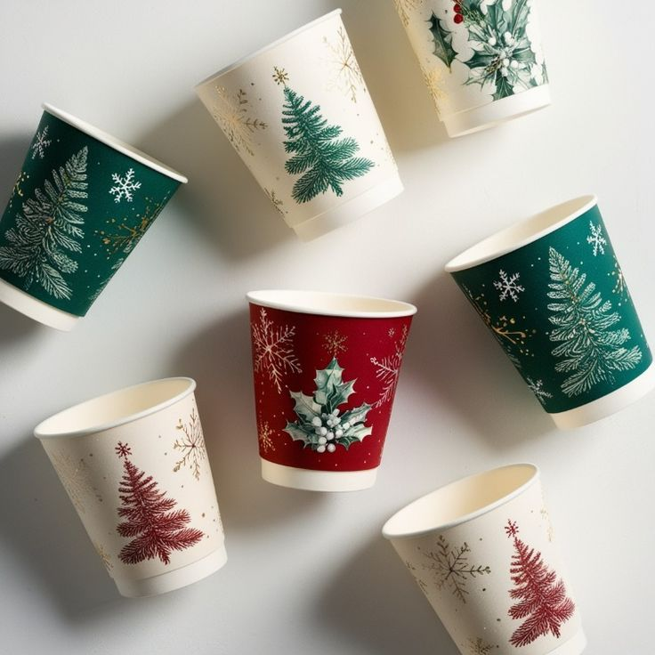
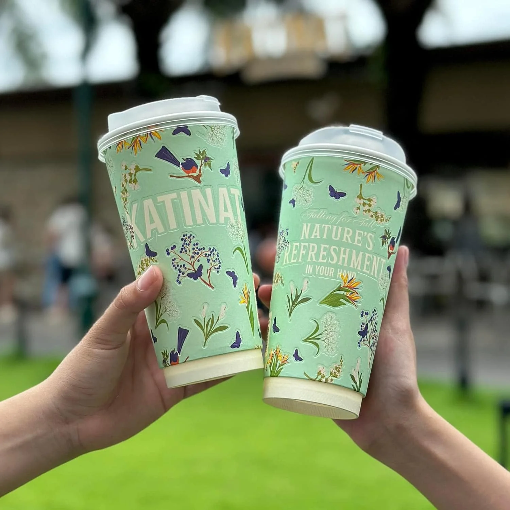

# **Cốc Giấy In Logo Mùa Lễ Hội: 5 Ý Tưởng Thu Hút Khách**

Mùa lễ hội là dịp các quán cà phê, trà sữa và cửa hàng đồ uống làm mới menu, trang trí không gian và triển khai các chương trình marketing. Tuy nhiên, nếu cốc giấy vẫn giữ nguyên thiết kế quanh năm, hình ảnh bao bì có thể chưa tạo được sự đồng bộ với chiến dịch. **Cốc giấy in logo theo chủ đề lễ hội** là một cách để thương hiệu xuất hiện nhất quán hơn trong trải nghiệm của khách hàng. Để thiết kế vừa bắt mắt vừa phù hợp sản xuất, chủ quán cần cân nhắc từ màu sắc, bố cục logo đến dung tích cốc và phương án in. Dưới đây là 5 ý tưởng cùng những lưu ý kỹ thuật giúp bạn lên kế hoạch hiệu quả hơn.

## **1. Vì Sao Nên Thiết Kế Cốc Giấy In Logo Theo Mùa Lễ Hội?**

Cốc giấy không chỉ dùng để đựng đồ uống mà còn là một phần trong hình ảnh thương hiệu. Khi thiết kế được đồng bộ với menu và hoạt động truyền thông, chiếc cốc có thể tạo thêm điểm nhấn trong trải nghiệm mua hàng.

* **Làm mới hình ảnh quán:** Họa tiết Halloween, Giáng sinh hoặc Tết giúp bao bì phù hợp với không khí từng mùa.
* **Tăng khả năng nhận diện:** Logo xuất hiện rõ ràng trên cốc giúp khách dễ nhận ra thương hiệu khi mang đồ uống đi.
* **Hỗ trợ hoạt động marketing:** Cốc có thiết kế đẹp có thể trở thành đạo cụ chụp ảnh, check-in hoặc kết hợp với chương trình ưu đãi.

Để tránh phải thay đổi toàn bộ nhận diện mỗi dịp lễ, quán nên giữ các yếu tố cốt lõi như logo, màu thương hiệu và kiểu chữ, đồng thời thay đổi họa tiết hoặc thông điệp theo từng chiến dịch.

## **2. 5 Ý Tưởng Thiết Kế Cốc Giấy In Logo Thu Hút Khách**

### **2.1. Cốc giấy Halloween với họa tiết nổi bật**

Halloween là dịp phù hợp để thử nghiệm những thiết kế trẻ trung, nổi bật với các gam màu như cam, đen, tím hoặc phối cùng màu nhận diện của quán. Hình ảnh bí ngô, dơi, mạng nhện hay những nhân vật hoạt hình ngộ nghĩnh có thể tạo nên diện mạo thú vị cho chiếc cốc.

Với phong cách này, quán nên đặt logo tại vị trí dễ quan sát, kết hợp họa tiết xung quanh để tạo bố cục hài hòa. Những mẫu cốc có hình ảnh bắt mắt cũng có thể được sử dụng làm điểm nhấn cho menu Halloween, góc check-in hoặc các chương trình ưu đãi theo mùa.

### **2.2. Cốc giấy Giáng sinh rực rỡ**

Không khí Giáng sinh thường gắn liền với các gam màu đỏ, xanh lá, trắng và những hình ảnh quen thuộc như cây thông, bông tuyết, hộp quà hay ngôi sao. Khi ứng dụng lên cốc giấy, các họa tiết này giúp bao bì hòa cùng không khí lễ hội và tạo cảm giác đồng bộ với không gian cửa hàng.

Quán có thể lựa chọn phong cách truyền thống với màu sắc nổi bật hoặc hướng đến thiết kế tối giản bằng những đường nét thanh mảnh. Logo được kết hợp khéo léo cùng họa tiết chủ đạo sẽ giúp chiếc cốc vừa thể hiện tinh thần Giáng sinh, vừa duy trì dấu ấn riêng của thương hiệu.

### **2.3. Cốc giấy Tết kết hợp họa tiết văn hóa Việt**

.jpeg)

Với dịp Tết, những hình ảnh như hoa mai, hoa đào, mây cách điệu hay lời chúc năm mới mang đến nhiều cảm hứng sáng tạo. Tùy theo định vị thương hiệu, quán có thể lựa chọn phong cách truyền thống, hiện đại hoặc kết hợp cả hai để tạo nên mẫu cốc phù hợp với nhóm khách hàng của mình.

Một gợi ý là sử dụng màu nhận diện làm nền tảng, sau đó điểm xuyết họa tiết Tết và thông điệp ngắn trên thân cốc. Cách thiết kế này giúp bao bì có không khí đầu năm, đồng thời dễ dàng kết hợp với menu đồ uống theo mùa, túi giấy và các ấn phẩm truyền thông của quán.

### **2.4. Cốc giấy phiên bản giới hạn theo bộ sưu tập**

Thay vì chỉ sản xuất một mẫu cốc, quán có thể xây dựng bộ sưu tập gồm 2-3 phiên bản dựa trên cùng một concept. Logo, màu chủ đạo và kiểu chữ được giữ thống nhất, trong khi họa tiết hoặc thông điệp thay đổi giữa các mẫu.

Ý tưởng này phù hợp với các quán có nhiều món đồ uống theo mùa hoặc thường xuyên triển khai hoạt động truyền thông. Chẳng hạn, một bộ sưu tập Giáng sinh có thể gồm các mẫu cốc với hình cây thông, hộp quà và bông tuyết, tạo sự đa dạng nhưng vẫn thống nhất về nhận diện.

### **2.5. Cốc giấy in logo kết hợp QR code**

Bên cạnh yếu tố thẩm mỹ, cốc giấy còn có thể trở thành cầu nối giữa khách hàng và các kênh truyền thông của quán. Việc tích hợp QR code dẫn đến menu, trang mạng xã hội, chương trình thành viên hoặc ưu đãi theo mùa giúp mở rộng trải nghiệm từ chiếc cốc đến các hoạt động trực tuyến.

Để thiết kế hiệu quả, QR code nên được bố trí tại vị trí dễ nhìn, có độ tương phản phù hợp và khoảng trống xung quanh để thuận tiện quét mã. Quán cũng có thể kết hợp cùng lời chúc, hashtag hoặc thông điệp ngắn theo chủ đề lễ hội để khuyến khích khách hàng tương tác.

## **3. Lưu Ý Kỹ Thuật Khi Thiết Kế Và In Cốc Giấy Logo**

Một thiết kế đẹp trên màn hình chưa chắc đã cho kết quả tương tự khi in lên cốc. Để hạn chế sai lệch, cần xem xét đồng thời dung tích, kết cấu cốc và yêu cầu của file in.

### **3.1. Chọn dung tích cốc phù hợp với menu**

Dưới đây là một số dung tích phổ biến và ứng dụng tham khảo:

| **Dung tích** | **Quy đổi gần đúng** | **Ứng dụng gợi ý**                    |
| ------------- | -------------------- | ------------------------------------- |
| 4 oz          | 120 ml               | Espresso hoặc đồ uống dùng thử        |
| 8 oz          | 240 ml               | Cà phê, trà hoặc khẩu phần nhỏ        |
| 12 oz         | 350 ml               | Cà phê, trà và đồ uống mang đi        |
| 16 oz         | 470 ml               | Trà sữa, trà trái cây và đồ uống lạnh |

Quy đổi sử dụng đơn vị US fluid ounce. Dung tích rót thực tế có thể thấp hơn dung tích danh nghĩa và còn phụ thuộc lượng đá, topping cũng như công thức pha chế.

### **3.2. Lựa chọn kết cấu cốc theo loại đồ uống**

Kết cấu cốc giấy ảnh hưởng đến khả năng cách nhiệt, độ cứng và diện tích thể hiện logo. Ba loại phổ biến gồm:

| **Loại cốc**                        | **Điểm cần cân nhắc**                              | **Gợi ý ứng dụng**                                     |
| ----------------------------------- | -------------------------------------------------- | ------------------------------------------------------ |
| **Cốc giấy 1 lớp (Single Wall)**    | Cấu tạo đơn giản, giá thành tối ưu                 | Đồ uống lạnh (dùng tráng 2 mặt PE) hoặc đồ uống ấm vừa |
| **Cốc giấy 2 lớp (Double Wall)**    | Có thêm lớp giấy đệm bên ngoài giúp cách nhiệt     | Đồ uống nóng, không cần dùng thêm tay vịn (sleeve)     |
| **Cốc giấy gợn sóng (Ripple Wall)** | Bề mặt sóng gân nổi, cầm bám tay và cách nhiệt tốt | Quán muốn tạo trải nghiệm cầm nắm cao cấp, khác biệt   |

### **3.3. Màu sắc và phương án in cần được kiểm tra ra sao?**

* **Hệ màu CMYK:** Tất cả file thiết kế in ấn phải chuyển về hệ màu CMYK.
* **Kiểm soát độ chênh lệch màu:** Mực in trên chất liệu giấy Kraft nâu sẽ tối hơn so với in trên giấy trắng.
* **Phương án in:** Tùy thuộc vào số lượng đặt hàng và số lượng màu sắc trên logo, xưởng sẽ tư vấn công nghệ in lưới (in lụa) cho đơn hàng nhỏ hoặc in Offset/Flexo cho các đơn hàng thương mại số lượng lớn.

## **4. CFC Tư Vấn In Cốc Giấy Logo Theo Yêu Cầu**

Để cốc giấy vừa nổi bật tinh thần mùa lễ hội vừa tối ưu chi phí vận hành, chủ quán không cần phải tốn thời gian nghiên cứu kỹ thuật hay tự chuẩn bị file in phức tạp. CFC cung cấp giải pháp trọn gói từ A - Z, khách hàng hoàn toàn không phải làm gì.

CFC sẽ trực tiếp đồng hành và đảm nhận toàn bộ quy trình:

* **Tư vấn giải pháp toàn diện:** Đề xuất chính xác quy cách cốc (1 lớp hay 2 lớp cách nhiệt), chọn size oz/ml chuẩn theo menu và tư vấn loại nắp tối ưu cho các chiến dịch marketing lễ hội.
* **Xử lý trọn gói khâu thiết kế:** Không cần có sẵn file chuyên nghiệp, đội ngũ thiết kế của CFC sẽ hỗ trợ lên ý tưởng, tinh chỉnh logo, phối màu chuẩn CMYK và dựng mockup 3D hoàn toàn miễn phí.
* **Tối ưu chi phí & tiến độ:** Tính toán số lượng in phù hợp ngân sách và chủ động điều phối sản xuất, đảm bảo giao hàng đúng hẹn cho sự kiện hoặc ngày khai trương của quán.

Bạn chỉ cần chia sẻ tên thương hiệu cùng ý tưởng mong muốn, mọi công đoạn từ tư vấn, thiết kế đến sản xuất thành phẩm hãy để CFC đảm nhận. Liên hệ ngay với CFC để sở hữu mẫu cốc giấy in logo ấn tượng cho mùa lễ hội này!

## **5. Câu Hỏi Thường Gặp**

### **Cốc giấy in logo có thể thiết kế theo chủ đề lễ hội riêng không?**

Có thể xây dựng thiết kế theo chủ đề Halloween, Giáng sinh, Tết hoặc concept riêng của thương hiệu. File thiết kế cần được kiểm tra theo mẫu cốc và phương án in trước khi sản xuất.

### **Nên chọn cốc giấy dung tích bao nhiêu để in logo?**

Cần căn cứ vào định lượng đồ uống, lượng đá và topping, đồng thời kiểm tra kích thước thực tế của mẫu cốc. Các dung tích 8 oz, 12 oz và 16 oz là những lựa chọn phổ biến cho menu cà phê, trà sữa và đồ uống mang đi.

### **Chưa có file thiết kế thì có đặt in cốc giấy theo yêu cầu được không?**

**Hoàn toàn được.** CFC có đội ngũ hỗ trợ thiết kế trọn gói từ ý tưởng, căn chỉnh logo đến lên phối cảnh 3D miễn phí; bạn chỉ cần cung cấp tên thương hiệu, thông tin liên hệ hoặc phong cách mong muốn là có thể tiến hành đặt in ngay.

### **Nên đặt in cốc giấy mùa lễ hội trước bao lâu?**

Nên đặt in cốc giấy trước mùa lễ hội khoảng 3-4 tuần để có đủ thời gian hoàn thiện thiết kế, duyệt mẫu và sản xuất. Với đơn hàng số lượng lớn, thiết kế nhiều màu hoặc nhiều phiên bản, quán nên chuẩn bị trước 4-6 tuần để chủ động tiến độ và hạn chế phát sinh khi cần chỉnh sửa.
